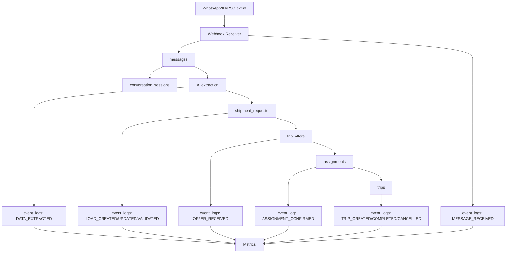

# Lineage De Datos

Este documento define el linaje basico de datos desde canal conversacional hasta dominio, auditoria y metricas.

## Lineage Operativo

```text
WhatsApp/KAPSO event
-> webhook
-> messages
-> conversation_sessions
-> extraccion AI
-> shipment_requests
-> event_logs
-> trip_offers
-> assignments
-> trips
-> metricas
```

Otros recorridos de datos del alcance:

```text
WhatsApp carrier -> messages/media -> CarrierOnboarding -> documentos privados -> revision de soporte -> estado aprobado/rechazado + EventLog
WhatsApp carrier -> messages -> CarrierRouteAvailability -> sugerencias de ruta/carga parcial -> respuesta del carrier -> proceso normal de Offer/Assignment/Trip
CarrierSearchPreference -> filtros de difusion
Backoffice Producer/Conversation -> lectura agregada de profiles + cargas + ofertas + viajes + mensajes/eventos con permisos
```

Las sugerencias de compatibilidad no crean ni reservan capacidad. Los documentos conservan metadata y acceso controlado; no se copian al lineage/analytics.

## Diagrama Mermaid



## Lineage Analitico

| Etapa | Entrada | Salida analitica | Riesgo |
| --- | --- | --- | --- |
| Canal | Webhook KAPSO/WhatsApp | Volumen de mensajes | Duplicados/reintentos. |
| Mensaje | `messages` | Mensajes por tipo, ambiguedad | Texto libre dificil. |
| Extraccion AI | `DATA_EXTRACTED` | Calidad de extraccion | Correcciones no registradas. |
| Carga | `shipment_requests` + eventos load | Funnel de demanda | Datos incompletos. |
| Oferta | `trip_offers` + eventos offer | Supply response | Respuestas ambiguas. |
| Assignment | `assignments` + eventos assignment | Match rate | Confirmacion no registrada. |
| Trip | `trips` + eventos trip | Completion/cancel rate | Cierre tardio. |
| Metricas | `event_logs` + tablas actuales | Dashboards | Definiciones inestables. |

## Donde Puede Perderse Calidad

- Webhooks duplicados sin idempotencia.
- Eventos fuera de orden.
- Mensajes de WhatsApp con audio mal transcripto.
- Ubicaciones rurales ambiguas.
- Productor o carrier duplicado por telefono/nombre.
- AI extraction sin `source_message_id`.
- Operador corrige datos sin generar `EventLog`.
- Cancelacion sin motivo.
- Precio estimado confundido con precio final.

## Como Auditar

Para auditar una operacion:

1. Buscar `shipment_request_id`.
2. Revisar `event_logs` por `entity_type/entity_id` y `correlation_id`.
3. Seguir `source_message_id` hacia `messages`.
4. Revisar `conversation_session_id`.
5. Confirmar eventos de validacion, publicacion, oferta, assignment y trip.
6. Verificar actor de decisiones criticas: debe ser `Operator`.

## Reconstruccion De Estado Desde EventLog

El estado actual vive en tablas transaccionales. El `EventLog` debe permitir reconstruir historia:

- Ordenar eventos por `occurred_at` y `created_at`.
- Agrupar por `entity_type` + `entity_id`.
- Aplicar cambios con `previous_state` y `new_state`.
- Validar que no haya transiciones invalidas.
- Identificar gaps: cambios de estado sin evento o eventos sin entidad.

Regla: si tabla actual y eventos difieren, se debe investigar antes de confiar en dashboards.

## Lineage Por Entidad

| Entidad | Fuente primaria | Eventos clave | Metricas derivadas |
| --- | --- | --- | --- |
| `messages` | Webhook KAPSO/WhatsApp | `MESSAGE_RECEIVED`, `MESSAGE_SENT` | Volumen, tiempos, ambiguedad. |
| `shipment_requests` | Mensaje + operador/backend | `LOAD_CREATED`, `LOAD_VALIDATED`, `LOAD_PUBLISHED` | Cargas, validacion, demanda. |
| `trip_offers` | Respuesta carrier | `OFFER_RECEIVED`, `OFFER_UPDATED` | Respuesta, ofertas por carga. |
| `assignments` | Operador | `ASSIGNMENT_CREATED`, `ASSIGNMENT_CONFIRMED` | Match, tiempo hasta match. |
| `trips` | Assignment confirmado | `TRIP_CREATED`, `TRIP_COMPLETED`, `TRIP_CANCELLED` | Completion/cancel rate. |
| `payment_terms` | Operador/oferta | Eventos de assignment/trip | Revenue estimado. |
| `risk_flags` | AI/operador | `HUMAN_REVIEW_REQUESTED`, incidencias | Calidad y riesgo. |

## Riesgos Del Lineage

1. Correlation IDs ausentes dificultan reconstruccion.
2. Eventos tecnicos pueden confundirse con eventos de negocio.
3. Correcciones manuales sin evento rompen auditoria.
4. Tablas actuales pueden quedar desincronizadas de eventos.
5. KAPSO puede reenviar eventos duplicados si idempotencia falla.

## Decisiones Pendientes Con Negocio

1. Que correcciones manuales son obligatorias de auditar.
2. Cuanto detalle guardar sobre motivos de cancelacion.
3. Quien puede corregir datos historicos.
4. Que eventos debe revisar un operador antes de cerrar viaje.
5. Retencion de mensajes originales.

## Proximo Paso Recomendado

Definir casos de auditoria end-to-end y probar si el lineage permite reconstruirlos sin mirar chats manualmente.
