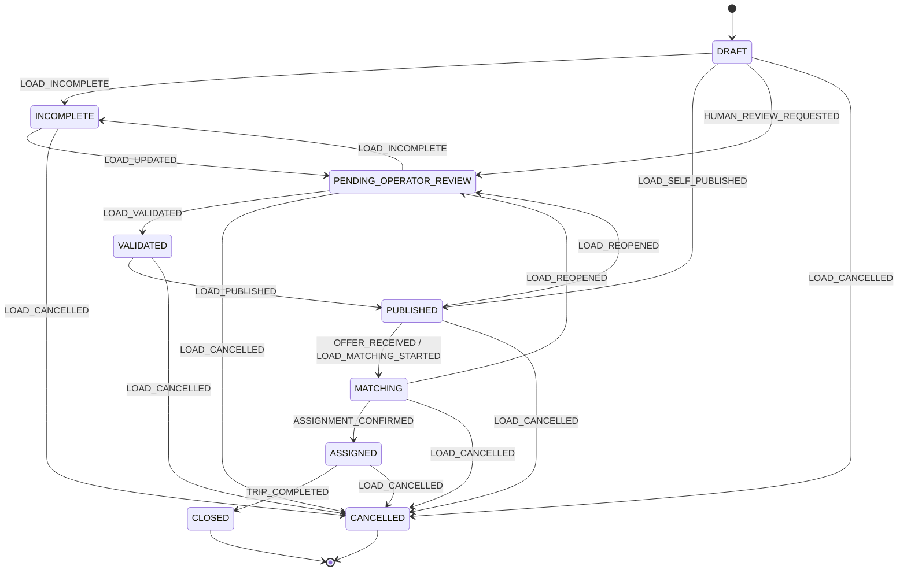
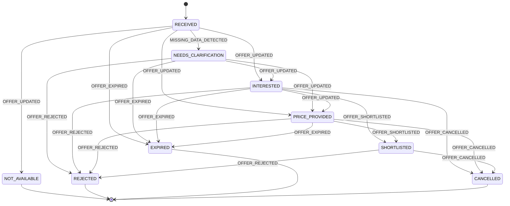
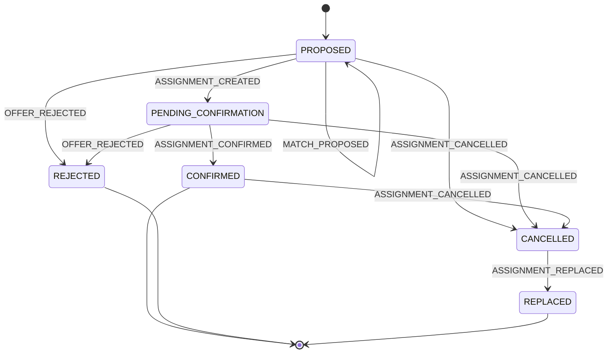
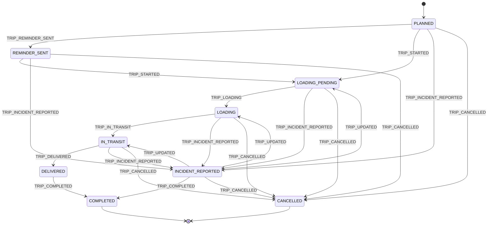

# Maquinas De Estado

Este documento define maquinas de estado para `LivestockLoad`, `Offer`, `Assignment` y `Trip`, y registra estados candidatos para homologacion y disponibilidad de recorrido. Estos dos ultimos requieren completar reglas de producto antes de convertir los estados candidatos en contrato de implementacion.

No define base de datos, APIs ni arquitectura tecnica. El objetivo es asegurar consistencia operativa y evitar que el MVP mezcle necesidad, interes, asignacion y ejecucion.

## Actores Permitidos

| Actor | Rol |
| --- | --- |
| `Producer` | Inicia o corrige informacion de la necesidad. |
| `Carrier` | Responde oportunidades, consulta, acepta o cancela disponibilidad. |
| `Operator` | Soporte, excepciones, auditoria, cancelaciones y correcciones puntuales. |
| `Bot` | Captura datos, pregunta y envia recordatorios simples. |
| `AI Agent` | Extrae, clasifica, resume y sugiere sin decidir. |
| `System` | Registra, publica, notifica y mantiene estados bajo reglas definidas. |

## Reglas Globales

- Una `LivestockLoad` con datos minimos puede pasar de `DRAFT` a `PUBLISHED` por confirmacion del productor.
- Un `Offer` no puede pasar directo a `Assignment.CONFIRMED`.
- Un `Assignment` queda `CONFIRMED` y el `Trip` en `PLANNED` cuando el carrier expresa interes y el productor acepta explicitamente esa oferta.
- Un `Trip` no puede empezar sin `Assignment.CONFIRMED`.
- Antes de iniciar un `Trip` deben estar identificados el `Driver` y el `Vehicle` que lo ejecutan, y cumplirse los controles de revision acordados para ambos; la aprobacion del carrier no los sustituye.
- El operador puede crear un `Assignment.PROPOSED` y un `Trip.PLANNED` al seleccionar manualmente una oferta; esto no confirma el viaje ni habilita inicio operativo.
- Cancelaciones requieren evento, actor, motivo si existe y revision de operador.
- Reprocesos permitidos:
  - Una carga publicada puede volver a `PENDING_OPERATOR_REVIEW` por correccion critica.
  - Un `Assignment` cancelado puede derivar en `REPLACED`.
  - Una oferta ambigua puede volver a aclaracion.

## A. `LivestockLoad`

### Estados

| Estado | Descripcion |
| --- | --- |
| `DRAFT` | Solicitud inicial recibida o carga en captura temprana. |
| `INCOMPLETE` | Faltan datos criticos. |
| `PENDING_OPERATOR_REVIEW` | Requiere revision o validacion humana. |
| `VALIDATED` | Datos minimos revisados por operador. |
| `PUBLISHED` | Oportunidad enviada o lista para enviar a transportistas. |
| `MATCHING` | Hay respuestas o evaluacion de opciones en curso. |
| `ASSIGNED` | Existe asignacion confirmada por doble aceptacion o soporte. |
| `CANCELLED` | La necesidad fue cancelada. |
| `CLOSED` | La carga queda cerrada por viaje completado o decision operativa. |

### Transiciones Validas

| Estado origen | Evento | Estado destino | Actor |
| --- | --- | --- | --- |
| `DRAFT` | `LOAD_INCOMPLETE` | `INCOMPLETE` | `Bot` / `AI Agent` |
| `DRAFT` | `LOAD_SELF_PUBLISHED` | `PUBLISHED` | `Producer` / `System` |
| `DRAFT` | `HUMAN_REVIEW_REQUESTED` | `PENDING_OPERATOR_REVIEW` | `Bot` / `AI Agent` / `System` |
| `INCOMPLETE` | `LOAD_UPDATED` | `PENDING_OPERATOR_REVIEW` | `Producer` / `Bot` / `Operator` |
| `PENDING_OPERATOR_REVIEW` | `LOAD_VALIDATED` | `VALIDATED` | `Operator` |
| `PENDING_OPERATOR_REVIEW` | `LOAD_INCOMPLETE` | `INCOMPLETE` | `Operator` |
| `VALIDATED` | `LOAD_PUBLISHED` | `PUBLISHED` | `Operator` / `System` |
| `PUBLISHED` | `OFFER_RECEIVED` | `MATCHING` | `Carrier` / `System` |
| `PUBLISHED` | `LOAD_MATCHING_STARTED` | `MATCHING` | `Carrier` / `System` |
| `PUBLISHED` | `LOAD_REOPENED` | `PENDING_OPERATOR_REVIEW` | `Operator` |
| `MATCHING` | `ASSIGNMENT_CONFIRMED` | `ASSIGNED` | `Producer` / `Operator` / `System` |
| `MATCHING` | `LOAD_REOPENED` | `PENDING_OPERATOR_REVIEW` | `Operator` |
| `ASSIGNED` | `TRIP_COMPLETED` | `CLOSED` | `Operator` / `System` |
| `DRAFT` | `LOAD_CANCELLED` | `CANCELLED` | `Producer` / `Operator` |
| `INCOMPLETE` | `LOAD_CANCELLED` | `CANCELLED` | `Producer` / `Operator` |
| `PENDING_OPERATOR_REVIEW` | `LOAD_CANCELLED` | `CANCELLED` | `Producer` / `Operator` |
| `VALIDATED` | `LOAD_CANCELLED` | `CANCELLED` | `Producer` / `Operator` |
| `PUBLISHED` | `LOAD_CANCELLED` | `CANCELLED` | `Producer` / `Operator` |
| `MATCHING` | `LOAD_CANCELLED` | `CANCELLED` | `Producer` / `Operator` |
| `ASSIGNED` | `LOAD_CANCELLED` | `CANCELLED` | `Operator` |

### Diagrama Mermaid

### Transiciones Invalidas

| Transicion invalida | Motivo |
| --- | --- |
| `INCOMPLETE` -> `PUBLISHED` | Faltan datos criticos y no hubo validacion humana. |
| `DRAFT` -> `ASSIGNED` | Se saltean captura, publicacion y matching. |
| `PUBLISHED` -> `ASSIGNED` sin `ASSIGNMENT_CONFIRMED` | Una respuesta no equivale a asignacion. |
| `CANCELLED` -> `PUBLISHED` | Una carga cancelada debe reabrirse como nueva necesidad o decision explicita. |
| `CLOSED` -> `MATCHING` | Una carga cerrada no debe volver a buscar transportista sin reapertura operativa documentada. |

## B. `Offer`

### Estados

| Estado | Descripcion |
| --- | --- |
| `RECEIVED` | Respuesta recibida de un carrier. |
| `NEEDS_CLARIFICATION` | La respuesta es ambigua o incompleta. |
| `INTERESTED` | El carrier informa interes o disponibilidad. |
| `NOT_AVAILABLE` | El carrier informa que no puede tomar la carga. |
| `PRICE_PROVIDED` | El carrier informa precio estimado o condicion economica. |
| `SHORTLISTED` | El operador la considera candidata. |
| `REJECTED` | El operador descarta la oferta. |
| `EXPIRED` | La respuesta pierde vigencia operativa. |
| `CANCELLED` | El carrier retira su interes o disponibilidad. |

### Transiciones Validas

| Estado origen | Evento | Estado destino | Actor |
| --- | --- | --- | --- |
| `RECEIVED` | `MISSING_DATA_DETECTED` | `NEEDS_CLARIFICATION` | `AI Agent` / `Operator` |
| `RECEIVED` | `OFFER_UPDATED` | `INTERESTED` | `Carrier` / `Operator` |
| `RECEIVED` | `OFFER_UPDATED` | `NOT_AVAILABLE` | `Carrier` / `Operator` |
| `RECEIVED` | `OFFER_UPDATED` | `PRICE_PROVIDED` | `Carrier` / `Operator` |
| `NEEDS_CLARIFICATION` | `OFFER_UPDATED` | `INTERESTED` | `Carrier` / `Operator` |
| `NEEDS_CLARIFICATION` | `OFFER_UPDATED` | `PRICE_PROVIDED` | `Carrier` / `Operator` |
| `NEEDS_CLARIFICATION` | `OFFER_REJECTED` | `REJECTED` | `Operator` |
| `INTERESTED` | `OFFER_UPDATED` | `PRICE_PROVIDED` | `Carrier` / `Operator` |
| `INTERESTED` | `OFFER_SHORTLISTED` | `SHORTLISTED` | `Operator` |
| `PRICE_PROVIDED` | `OFFER_SHORTLISTED` | `SHORTLISTED` | `Operator` |
| `INTERESTED` | `OFFER_REJECTED` | `REJECTED` | `Operator` |
| `PRICE_PROVIDED` | `OFFER_REJECTED` | `REJECTED` | `Operator` |
| `SHORTLISTED` | `OFFER_REJECTED` | `REJECTED` | `Operator` |
| `RECEIVED` | `OFFER_EXPIRED` | `EXPIRED` | `System` / `Operator` |
| `NEEDS_CLARIFICATION` | `OFFER_EXPIRED` | `EXPIRED` | `System` / `Operator` |
| `INTERESTED` | `OFFER_EXPIRED` | `EXPIRED` | `System` / `Operator` |
| `PRICE_PROVIDED` | `OFFER_EXPIRED` | `EXPIRED` | `System` / `Operator` |
| `INTERESTED` | `OFFER_CANCELLED` | `CANCELLED` | `Carrier` / `Operator` |
| `PRICE_PROVIDED` | `OFFER_CANCELLED` | `CANCELLED` | `Carrier` / `Operator` |
| `SHORTLISTED` | `OFFER_CANCELLED` | `CANCELLED` | `Carrier` / `Operator` |

### Diagrama Mermaid

### Transiciones Invalidas

| Transicion invalida | Motivo |
| --- | --- |
| `RECEIVED` -> `SHORTLISTED` por `AI Agent` | El shortlist es una decision operativa del operador. |
| `INTERESTED` -> `Assignment.CONFIRMED` | Una oferta no confirma asignacion ni viaje. |
| `NOT_AVAILABLE` -> `SHORTLISTED` | No se debe seleccionar una respuesta negativa. |
| `EXPIRED` -> `SHORTLISTED` | Una oferta vencida requiere nueva confirmacion del carrier. |
| `CANCELLED` -> `PRICE_PROVIDED` | El carrier retiro su interes; se requiere nueva oferta. |

## C. `Assignment`

### Estados

| Estado | Descripcion |
| --- | --- |
| `PROPOSED` | Opcion sugerida o preparada para evaluar. |
| `PENDING_CONFIRMATION` | Soporte esta confirmando con las partes en un caso manual. |
| `CONFIRMED` | El match quedo confirmado por doble aceptacion o soporte. |
| `REJECTED` | La opcion fue descartada antes de confirmar. |
| `CANCELLED` | La asignacion confirmada o en proceso fue cancelada. |
| `REPLACED` | La asignacion fue reemplazada por otra opcion. |

### Transiciones Validas

| Estado origen | Evento | Estado destino | Actor |
| --- | --- | --- | --- |
| `PROPOSED` | `MATCH_PROPOSED` | `PROPOSED` | `AI Agent` / `System` / `Operator` |
| `PROPOSED` | `PRODUCER_OFFER_ACCEPTED` | `CONFIRMED` | `Producer` / `System` |
| `PROPOSED` | `ASSIGNMENT_CREATED` | `PENDING_CONFIRMATION` | `Operator` |
| `PROPOSED` | `ASSIGNMENT_CANCELLED` | `CANCELLED` | `Operator` |
| `PROPOSED` | `OFFER_REJECTED` | `REJECTED` | `Operator` |
| `PENDING_CONFIRMATION` | `ASSIGNMENT_CONFIRMED` | `CONFIRMED` | `Operator` / `Producer` |
| `PENDING_CONFIRMATION` | `ASSIGNMENT_CANCELLED` | `CANCELLED` | `Operator` / `Carrier` / `Producer` |
| `PENDING_CONFIRMATION` | `OFFER_REJECTED` | `REJECTED` | `Operator` |
| `CONFIRMED` | `ASSIGNMENT_CANCELLED` | `CANCELLED` | `Operator` / `Carrier` / `Producer` |
| `CANCELLED` | `ASSIGNMENT_REPLACED` | `REPLACED` | `Operator` |

### Diagrama Mermaid

### Transiciones Invalidas

| Transicion invalida | Motivo |
| --- | --- |
| `PROPOSED` -> `CONFIRMED` por `AI Agent` | El agente no puede confirmar match. |
| `INTERESTED` -> `CONFIRMED` sin aceptacion del productor | El interes del carrier no alcanza para asignar. |
| `REJECTED` -> `CONFIRMED` | Una opcion descartada requiere nuevo proceso. |
| `CANCELLED` -> `CONFIRMED` | Una asignacion cancelada no se reactiva sin nueva confirmacion. |
| `CONFIRMED` -> `PROPOSED` | No se debe degradar una asignacion confirmada sin cancelacion o reemplazo. |

## D. `Trip`

### Estados

| Estado | Descripcion |
| --- | --- |
| `PLANNED` | Viaje planificado desde asignacion confirmada o desde oferta seleccionada manualmente por operador. |
| `REMINDER_SENT` | Se envio recordatorio previo. |
| `LOADING_PENDING` | Viaje pendiente de carga. |
| `LOADING` | La carga esta en proceso. |
| `IN_TRANSIT` | El viaje esta en curso. |
| `DELIVERED` | Se informo entrega o llegada. |
| `COMPLETED` | El operador cerro el viaje. |
| `INCIDENT_REPORTED` | Se reporto incidencia que requiere atencion. |
| `CANCELLED` | Viaje cancelado. |

### Transiciones Validas

Antes de `TRIP_STARTED` o del paso a `IN_TRANSIT`, el backend exige: Carrier en `APPROVED`, conductor y vehiculo asignados al viaje, pertenencia de ambos al Carrier del viaje, conductor activo y aprobado, y vehiculo activo y aprobado. La asignacion de conductor/unidad se permite solo mientras el viaje esta `PLANNED` y registra `TRIP_CREW_ASSIGNED`. Editar datos de vehiculo invalida su aprobacion anterior y requiere nueva revision. Los estados operativos no se cambian mediante el PATCH generico del viaje.

| Estado origen | Evento | Estado destino | Actor |
| --- | --- | --- | --- |
| `PLANNED` | `TRIP_REMINDER_SENT` | `REMINDER_SENT` | `System` / `Bot` |
| `PLANNED` | `TRIP_STARTED` | `LOADING_PENDING` | `Operator` / `Carrier` |
| `REMINDER_SENT` | `TRIP_STARTED` | `LOADING_PENDING` | `Operator` / `Carrier` |
| `LOADING_PENDING` | `TRIP_LOADING` | `LOADING` | `Operator` / `Carrier` / `Producer` |
| `LOADING` | `TRIP_IN_TRANSIT` | `IN_TRANSIT` | `Operator` / `Carrier` |
| `IN_TRANSIT` | `TRIP_DELIVERED` | `DELIVERED` | `Operator` / `Carrier` / `Producer` |
| `DELIVERED` | `TRIP_COMPLETED` | `COMPLETED` | `Operator` |
| `PLANNED` | `TRIP_INCIDENT_REPORTED` | `INCIDENT_REPORTED` | `Operator` / `Carrier` / `Producer` |
| `REMINDER_SENT` | `TRIP_INCIDENT_REPORTED` | `INCIDENT_REPORTED` | `Operator` / `Carrier` / `Producer` |
| `LOADING_PENDING` | `TRIP_INCIDENT_REPORTED` | `INCIDENT_REPORTED` | `Operator` / `Carrier` / `Producer` |
| `LOADING` | `TRIP_INCIDENT_REPORTED` | `INCIDENT_REPORTED` | `Operator` / `Carrier` / `Producer` |
| `IN_TRANSIT` | `TRIP_INCIDENT_REPORTED` | `INCIDENT_REPORTED` | `Operator` / `Carrier` / `Producer` |
| `INCIDENT_REPORTED` | `TRIP_UPDATED` | `LOADING_PENDING` | `Operator` |
| `INCIDENT_REPORTED` | `TRIP_UPDATED` | `LOADING` | `Operator` |
| `INCIDENT_REPORTED` | `TRIP_UPDATED` | `IN_TRANSIT` | `Operator` |
| `INCIDENT_REPORTED` | `TRIP_COMPLETED` | `COMPLETED` | `Operator` |
| `PLANNED` | `TRIP_CANCELLED` | `CANCELLED` | `Operator` / `Carrier` / `Producer` |
| `REMINDER_SENT` | `TRIP_CANCELLED` | `CANCELLED` | `Operator` / `Carrier` / `Producer` |
| `LOADING_PENDING` | `TRIP_CANCELLED` | `CANCELLED` | `Operator` / `Carrier` / `Producer` |
| `LOADING` | `TRIP_CANCELLED` | `CANCELLED` | `Operator` / `Carrier` / `Producer` |
| `IN_TRANSIT` | `TRIP_CANCELLED` | `CANCELLED` | `Operator` |
| `INCIDENT_REPORTED` | `TRIP_CANCELLED` | `CANCELLED` | `Operator` |

### Diagrama Mermaid

### Transiciones Invalidas

| Transicion invalida | Motivo |
| --- | --- |
| Sin `Assignment.CONFIRMED` ni seleccion manual de oferta por operador -> `PLANNED` | Un viaje no nace sin decision humana trazable. |
| `PLANNED` -> `COMPLETED` | Se saltean ejecucion y cierre operativo. |
| `REMINDER_SENT` -> `IN_TRANSIT` sin `TRIP_STARTED` | Falta confirmar inicio o carga. |
| `IN_TRANSIT` -> `COMPLETED` sin `TRIP_DELIVERED` | El cierre requiere confirmacion suficiente de entrega o decision del operador. |
| `CANCELLED` -> `IN_TRANSIT` | Un viaje cancelado requiere nueva asignacion o nuevo viaje. |

## E. `CarrierOnboarding` (alineado al proceso existente)

Estados conceptuales: `DRAFT`, `WAITING_DATA`, `WAITING_DOCUMENTS`, `PENDING_REVIEW`, `APPROVED`, `REJECTED` y `SUSPENDED`.

- El transportista puede completar/corregir sus datos y adjuntos antes de enviar la solicitud a revision.
- Soporte puede solicitar correcciones, aprobar o rechazar con motivo; cada cambio registra actor, fecha y `EventLog`.
- En el alcance MVP, solo `APPROVED` habilita difusion y matching; excepciones requieren una regla explicita y auditoria.
- Las condiciones exactas de aprobacion, tipos/vigencias de documentos y excepciones quedan pendientes de producto/operacion.

## F. `CarrierRouteAvailability` (estados candidatos)

La disponibilidad representa una intencion de recorrido/capacidad y no un viaje confirmado. Estados candidatos: `DRAFT`, `ACTIVE`, `PAUSED`, `CANCELLED`, `EXPIRED` y `FULL`. La transicion final y las reglas de capacidad multiple quedan pendientes.

- `DRAFT` puede pasar a `ACTIVE` cuando el transportista confirma los campos minimos acordados.
- El transportista puede pausar o cancelar; el sistema puede marcar `EXPIRED` por una politica temporal aun por definir.
- `FULL` solo se alcanza por capacidad comprometida en operaciones confirmadas, no por una sugerencia de matching.
- Cambiar ruta, ventana o capacidad de una disponibilidad activa requiere historial y reevaluar sugerencias relacionadas.
- Los avisos/matches parciales no crean una reserva ni cambian a `FULL` sin una regla de asignacion explicita.

## Riesgos Del Modelo Propuesto

1. Demasiados estados pueden generar carga operativa si el operador debe actualizarlos manualmente.
2. La separacion entre `Offer`, `Assignment` y `Trip` puede sentirse compleja al inicio, aunque evita mezclar interes, decision y ejecucion.
3. Los datos estimados vs confirmados pueden requerir disciplina operativa para no degradarse.
4. Si los eventos no se registran de forma consistente, analytics y auditoria pierden valor.
5. La ambiguedad de ubicaciones rurales puede producir estados incompletos frecuentes.

## Decisiones A Validar Con Negocio

1. Que datos son criticos para publicar una carga y cuales pueden quedar pendientes.
2. Que estados realmente necesita ver el operador en el dia a dia.
3. Cuando una oferta debe considerarse vencida o descartada.
4. Que informacion del productor puede compartirse con transportistas en el broadcast.
5. Que eventos son obligatorios para auditoria operativa desde el primer MVP.

## Siguiente Paso Recomendado

Revisar estas maquinas con un operador usando casos reales: carga incompleta, sin respuestas, cancelacion y reemplazo. Ajustar estados antes de disenar backend.

## Recorridos y seguimiento — ampliación 2026-10-25

Las preferencias habituales no acreditan disponibilidad. Comparar nodos geográficos canónicos y ordenados, sin eliminar la provincia ni resolver homónimos por inferencia. El viaje en IN_TRANSIT habilita tres controles (salida/mitad/llegada) vinculados al chofer y al escenario, independientes de los estados de entrega. Una posición informada no constituye prueba GPS continua ni cambia el estado del viaje. Los datos propios de ubicación y la geometría temporal del proveedor se tratan por separado.
