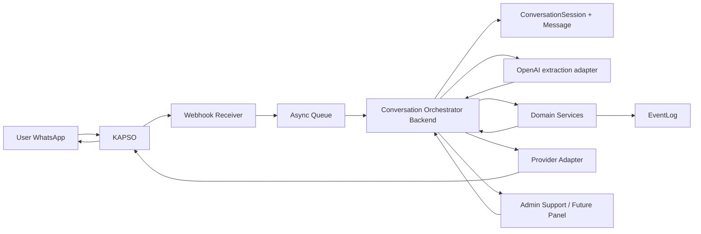

# Arquitectura Del Canal WhatsApp Con KAPSO Y OpenAI

Este documento define como encaja KAPSO como canal WhatsApp y OpenAI como proveedor IA invocado por el backend.

Principio central: WhatsApp y KAPSO transportan mensajes; el backend usa OpenAI para interpretar mensajes y es la unica fuente de verdad del negocio.

No se define codigo, base de datos fisica ni features fuera del MVP.

## Principios Innegociables

- WhatsApp es canal, no dominio.
- KAPSO es capa reemplazable mediante adapters.
- El backend es owner exclusivo del estado de negocio.
- KAPSO no persiste estado de negocio.
- KAPSO no ejecuta un agente conversacional de AGRO ni decide pricing, matching, asignacion, estados o cancelaciones.
- OpenAI se invoca desde el backend usando `OPENAI_API_KEY` y `OPENAI_MODEL`; la clave no se guarda en Kapso.
- El sistema debe poder operar sin KAPSO en modo degradado.
- Todo cambio relevante debe generar `EventLog`.

## Source Of Truth

El backend es owner exclusivo de:

| Concepto del pedido | Nombre canonico actual del dominio | Owner |
| --- | --- | --- |
| `ConversationSession` | `ConversationSession` | Backend |
| `Message` | `Message` | Backend |
| `ShipmentRequest` | `LivestockLoad` | Backend |
| `TripOffer` | `Offer` | Backend |
| `Assignment` | `Assignment` | Backend |
| `EventLog` | `EventLog` | Backend |

`ShipmentRequest` y `TripOffer` no cambian el modelo existente. Si aparecen en payloads externos, deben mapearse a `LivestockLoad` y `Offer`.

## Componentes

| Componente | Responsabilidad | Reglas |
| --- | --- | --- |
| WhatsApp Provider Adapter | Abstrae proveedor WhatsApp y sus formatos. | No contiene reglas de negocio. |
| KAPSO Adapter | Traduce webhooks y mensajes de KAPSO al contrato interno y transporta respuestas del backend. | Reemplazable; no persiste dominio. |
| Webhook Receiver | Recibe eventos entrantes, valida firma e idempotencia. | No ejecuta decisiones de negocio sin pasar por backend. |
| Conversation Orchestrator (backend) | Coordina conversacion, mensajes y servicios de dominio. | Owner de `ConversationSession` y `Message`; construye la vista previa antes de crear la carga. |
| Notification Service | Orquesta envios outbound hacia transportistas usando un provider WhatsApp generico. | No contiene reglas de matching ni asignacion; todo envio genera `EventLog`. |
| AI extraction adapter (backend) | Usa OpenAI para extraer campos candidatos de la solicitud. | La clave vive solo en backend; respuestas, consultas y acciones las controla el orquestador/dominio. |
| Domain Services | Aplican reglas de `LivestockLoad`, `Offer`, `Assignment`, `Trip` y estados. | Fuente de verdad de negocio. |
| Event Log | Registra eventos auditables y metricas. | Obligatorio para cambios relevantes. |
| Admin Panel (futuro) | Vista de soporte, auditoria e intervencion puntual. | No requerido para el flujo feliz self-service. |

## Diagrama Mermaid



## Flujo Inbound

```text
User
-> KAPSO
-> Webhook Receiver
-> Backend webhook
-> Conversation Orchestrator
-> OpenAI extraction client
-> Domain Services
-> EventLog
-> Backend reply via Kapso adapter
```

Pasos:

1. KAPSO recibe el mensaje entrante de WhatsApp.
2. KAPSO envia webhook al backend.
3. `Webhook Receiver` valida firma HMAC, idempotencia y estructura minima.
4. El evento se procesa de forma sincronica en el webhook actual.
5. `Conversation Orchestrator` crea o actualiza `ConversationSession` y `Message`.
6. El backend invoca OpenAI para extraer campos cuando corresponde; el modelo no decide acciones de dominio.
7. El backend normaliza y muestra una vista previa con campos faltantes y fecha canónica. Todavía no persiste una carga.
8. Tras la confirmación del productor, el backend parsea y valida de nuevo el contenido antes de crear/publicar la solicitud.
9. Se registra `EventLog` para las decisiones relevantes.
10. El backend redacta la respuesta y la envia por el adaptador de Kapso con idempotencia.

## Flujo Outbound

```text
Backend
-> Notification Service
-> Provider Adapter
-> KAPSO
-> WhatsApp
```

Pasos:

1. Backend decide enviar mensaje, template o flow.
2. `Notification Service` crea el intento outbound con idempotencia.
3. Provider Adapter traduce el intento al formato KAPSO.
4. KAPSO ejecuta el envio por WhatsApp.
5. Webhooks de entrega, error o respuesta vuelven al backend.
6. Backend registra el resultado del envio en `EventLog`.

## Flujos Conversacionales De Transportista

El backend puede encaminar mensajes a tres intenciones de dominio separadas: responder a una carga publicada, consultar oportunidades por origen/destino/fecha y declarar una disponibilidad propia de recorrido. El tercer flujo crea/actualiza `CarrierRouteAvailability`, no `Trip`.

El alta/homologacion es otro flujo guiado: recopila perfil y vehiculos, recibe adjuntos mediante el adaptador/media storage, permite corregir y deja el caso en revision de soporte. El canal solo transporta mensajes/media; el backend valida permisos, estado, datos y eventos.

Las preferencias geograficas del carrier alimentan difusion. Una disponibilidad concreta (ruta, fecha y capacidad) alimenta consulta/matching. Para retornos vacios, el backend ofrece alternativas directas o cercanas a un desvio aceptado; requiere respuesta explicita antes de comprometer capacidad o crear asignaciones.

Para alertas de nueva carga a transportistas:

- La publicacion de una `ShipmentRequest` por Admin/Ops genera una alerta por cada `carrier_id`.
- La key de idempotencia se deriva de `shipment_request_id + carrier_id + tipo de alerta`.
- Cada intento registra `CARRIER_NOTIFICATION_REQUESTED`.
- Cada resultado registra `CARRIER_NOTIFICATION_SENT` o `CARRIER_NOTIFICATION_FAILED`.
- Una falla parcial por transportista no debe revertir toda la publicacion; queda auditada para intervencion del operador.
- Sin credenciales reales, el backend usa un provider mock local para no depender de internet.

## Reglas Criticas De Webhooks

| Regla | Definicion |
| --- | --- |
| Firma HMAC | Todo webhook debe validar firma antes de procesar payload. |
| Eventos batched | El receiver debe aceptar multiples eventos en un mismo payload. |
| Idempotencia | Cada evento debe tener `idempotency_key` persistida. |
| Deduplicacion | No procesar dos veces el mismo evento por provider + key. |
| Async queue | El receiver debe responder rapido y procesar fuera de linea. |
| Reintentos | KAPSO puede reenviar eventos; deben ser seguros. |
| Desorden | Los eventos pueden llegar fuera de orden; el dominio valida estados. |
| Auditoria | Eventos invalidos o duplicados tambien deben dejar rastro operativo minimo. |

## Identificadores

| Identificador | Owner | Uso |
| --- | --- | --- |
| `provider_message_id` | KAPSO / WhatsApp provider | Identificar mensaje externo. |
| `conversation_id` | KAPSO y mapeo backend | Vincular conversacion externa con `ConversationSession`. |
| `workflow_execution_id` | KAPSO | Trazar workflow conversacional. |
| `phone_number` | Canal | Resolver posible `User`, `Producer` o `Carrier`. |
| `idempotency_key` | Backend al recibir | Deduplicar evento por provider + key. |
| `correlation_id` | Backend | Agrupar flujo completo: mensaje, extraccion, dominio, respuesta. |

Regla: los identificadores de KAPSO no son IDs de dominio. Deben mapearse, no reemplazar `loadId`, `offerId`, `assignmentId`, `tripId` ni `eventId`.

## Idempotencia

- Clave minima: `provider` + `idempotency_key`.
- Si KAPSO no envia key estable, usar combinacion segura de `provider_message_id`, `event_type`, `occurred_at` y `conversation_id`.
- Un duplicado no debe crear segundo `Message`, segunda `Offer` ni segundo `EventLog` de negocio.
- Los duplicados pueden registrar evento tecnico de deduplicacion si ayuda a debugging.
- Un outbound duplicado no debe reenviar una alerta ya marcada como `CARRIER_NOTIFICATION_SENT` para la misma carga y transportista.

## Error Handling

| Caso | Comportamiento |
| --- | --- |
| Firma invalida | Rechazar webhook y registrar alerta tecnica. |
| Payload invalido | Enviar a dead letter queue y marcar para revision. |
| Evento duplicado | Ignorar procesamiento de negocio y responder exito idempotente. |
| Error temporal | Retry con backoff. |
| Error permanente | Dead letter queue y handoff humano si afecta operacion. |
| Estado invalido | No cambiar dominio; registrar riesgo y pedir operador. |
| Respuesta ambigua | Mantener conversacion, pedir aclaracion o escalar. |

## Retry Policy Y Dead Letter Queue

- Reintentos deben ser seguros por idempotencia.
- Usar backoff progresivo para errores temporales.
- Despues de superar reintentos, enviar a dead letter queue.
- DLQ debe conservar payload original, headers, error y `correlation_id`.
- Si el evento afecta una operacion en curso, activar handoff humano.

## Fallback A Humano

Activar handoff cuando:

- Falta dato critico y el usuario no responde claro.
- Hay ubicacion ambigua.
- Hay cancelacion, incidencia o reproceso.
- Una respuesta corta puede implicar disponibilidad, precio o aceptacion.
- Una transicion de estado seria invalida.
- KAPSO workflow falla o queda inconsistente.

El handoff no cambia estado de dominio por si mismo. El operador decide y el backend registra.

## Modo Degradado Sin KAPSO

El sistema debe poder operar sin workflows ni agents de KAPSO:

```text
WhatsApp Provider
-> Webhook Receiver
-> Backend
-> Conversation Orchestrator
-> OpenAI extraction / Domain Services
-> Provider Adapter
-> WhatsApp Provider
```

En modo degradado:

- El backend recibe webhooks directos del provider.
- Los flows estructurados se reemplazan por preguntas de texto.
- Los workflows de KAPSO se reemplazan por decisiones del `Conversation Orchestrator`.
- El handoff se gestiona como tarea interna para operador.
- El dominio, estados y eventos no cambian.

## Relacion Con Dominio

| Dominio | Relacion con canal |
| --- | --- |
| `ConversationSession` | Representa conversacion backend, mapeada a `conversation_id` externo. |
| `Message` | Representa cada mensaje entrante o saliente, con `provider_message_id`. |
| `EventLog` | Registra recepcion, extraccion, respuesta, error, handoff y cambios de estado. |
| `LivestockLoad` | Se crea o actualiza solo por servicios de dominio, no por KAPSO. |
| `Offer` | Se crea desde respuesta de carrier solo luego de procesamiento backend. |
| `Assignment` | Se propone o confirma solo por backend con operador. |
| `Trip` | Nace solo desde `Assignment.CONFIRMED`. |

## Decisiones De Diseno

- KAPSO queda limitado a webhooks y transporte de mensajes para AGRO; el agente anterior no responde los chats AGRO.
- El workflow local `agro-whatsapp` permanece en borrador para evitar dos respuestas por mensaje.
- El backend invoca OpenAI con su propia configuracion, muestra una vista previa y vuelve a validar la confirmación antes de tocar el dominio.
- Broadcasts no son core del dominio; el backend decide a quien notificar.
- El adapter pattern es obligatorio para poder reemplazar KAPSO.

## Diagrama Resumido

```text
WhatsApp <-> KAPSO <-> Adapter/Webhook <-> Backend Orchestrator <-> OpenAI extraction adapter <-> Domain Services <-> EventLog
```

## Riesgos

1. KAPSO workflows pueden acumular reglas de negocio por conveniencia.
2. IDs externos pueden confundirse con IDs de dominio.
3. Reintentos o eventos duplicados pueden crear mensajes u ofertas repetidas.
4. Eventos fuera de orden pueden intentar transiciones invalidas.
5. Dependencia operativa de KAPSO puede afectar continuidad si falla.

## Mitigaciones

1. Mantener reglas de negocio solo en backend y revisarlas en PR/documentacion.
2. Mapear todos los IDs externos a entidades internas.
3. Persistir `idempotency_key` y deduplicar por provider + key.
4. Validar toda transicion contra `docs/08-state-machine.md`.
5. Mantener modo degradado documentado y probado.

## Proximo Paso Recomendado

Completar equivalencia de las acciones de transportista y productor, y verificar con proveedor simulado antes de reactivar el workflow de Sandbox.
