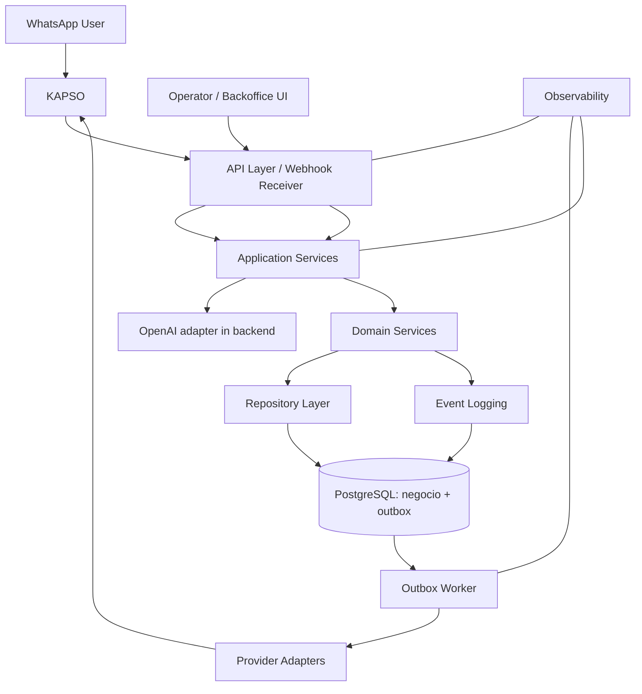

# Arquitectura Tecnica MVP

Este documento define una arquitectura tecnica implementable para AGRO Logistics MVP. No incluye codigo, migraciones ni decisiones de infraestructura final.

La arquitectura respeta los principios existentes:

- Backend como unica fuente de verdad.
- KAPSO como canal/adaptador reemplazable.
- Dominio desacoplado del canal.
- Event log obligatorio.
- Decisiones criticas confirmadas por reglas de dominio y doble aceptacion; admin queda para soporte.

## Stack Sugerido

| Componente | Eleccion sugerida | Justificacion |
| --- | --- | --- |
| Backend | FastAPI | MVP API-first, webhooks, async jobs y contratos claros. Menos superficie que Django para esta etapa. |
| DB | PostgreSQL | Modelo relacional, transacciones, JSON controlado, indices e integridad. |
| ORM | SQLAlchemy 2.x o SQLModel | Encaja bien con FastAPI y permite separar modelos de dominio de persistencia. |
| Jobs/queues | Redis Queue, Celery o equivalente simple | Webhooks deben responder rapido y procesar async. Elegir implementacion simple al iniciar. |
| WhatsApp/KAPSO adapter | Adapter propio en backend | KAPSO no contiene negocio y puede reemplazarse. |
| AI layer | Adaptador interno que invoca OpenAI desde el backend | OpenAI extrae campos candidatos; reglas y dominio validan y deciden. |
| Backoffice | UI de soporte sobre APIs backend protegidas | Seguimiento y revision de excepciones, homologacion y perfiles; no sustituye reglas de dominio. |
| Observabilidad | Logs estructurados, correlation_id, metricas de jobs/webhooks | Necesario para auditoria, debugging y operacion. |

FastAPI es la recomendacion inicial porque el MVP es transaccional, conversacional y orientado a integraciones. Django puede ser considerado si el admin panel pasa a ser el eje principal, pero para este paso agrega mas estructura de la necesaria.

## Capas

| Capa | Responsabilidad | Reglas |
| --- | --- | --- |
| API layer | Endpoints HTTP, validacion superficial, auth, request/response. | Sin logica de negocio. |
| Application services | Casos de uso: crear carga, publicar, registrar oferta, confirmar assignment. | Orquesta dominio, repositorios, agents y eventos. |
| Domain services | Reglas, validaciones, transiciones de estado. | Fuente de reglas del MVP. |
| Repository layer | Persistencia transaccional. | No decide negocio. |
| Provider adapters | KAPSO/WhatsApp, AI provider, outbound messaging. | Reemplazables, sin dominio. |
| AI extraction adapter | Extraccion de solicitudes y normalizacion asistida. | Usa `AI_PROVIDER`, `OPENAI_API_KEY` y `OPENAI_MODEL`; no persiste ni decide estado. |
| Event logging | Registro auditable de cambios y decisiones. | Obligatorio en cambios relevantes. |
| Background jobs | Procesamiento async de webhooks y despacho/reintento de outbox. | Idempotentes; resultado de red ambiguo se concilia, no se reenvia a ciegas. |

## Principios Tecnicos

- El dominio no depende de WhatsApp, KAPSO ni provider de AI.
- Todo webhook es idempotente.
- Toda accion critica es idempotente o transaccional.
- Todo cambio de estado genera `EventLog`.
- Las transiciones de estado se centralizan en domain services.
- Controllers/API handlers no contienen logica de negocio.
- KAPSO no contiene reglas comerciales ni cambia estados de dominio.
- Mensajes y eventos externos se normalizan antes de tocar dominio.

## Capacidades De Producto En Alcance

- La conversacion de WhatsApp puede iniciar carga de productor, solicitud de homologacion o disponibilidad de recorrido de transportista. El orquestador identifica el flujo y delega validacion/transiciones a servicios de dominio.
- Matching separa difusion por preferencias de zona de busqueda por disponibilidad concreta. Un servicio puede sugerir cargas directas o cercanas al corredor segun fecha, carga, unidad, equipo, capacidad y desvio declarado.
- Una sugerencia de ruta parcial no reserva capacidad ni crea otra asignacion. La operacion transaccional que comprometa capacidad debe definirse antes de implementar multiples cargas por recorrido.
- Backoffice consume APIs protegidas para revision de carriers, conversaciones cronologicas y ficha de productores. El cliente no debe acceder directamente a proveedores de WhatsApp ni a almacenamiento documental.
- Los adjuntos de homologacion se guardan en almacenamiento privado; el backend conserva metadata y estado de revision, no URLs publicas de acceso abierto.

## Diagrama Mermaid

## Flujos Tecnicos

### Inbound WhatsApp

1. KAPSO recibe mensaje o evento.
2. Webhook entra al API layer.
3. Se valida HMAC e idempotencia.
4. Se persiste recibo tecnico minimo y se encola job.
5. Job normaliza evento y crea/actualiza `ConversationSession` y `Message`.
6. AI layer interpreta si corresponde.
7. Application service llama domain services.
8. Se registran `EventLog` y respuesta si aplica.

### Outbound Notification

1. Backend decide outbound intent.
2. Application service valida contexto y permisos.
3. En SQL, el intent se guarda en `notification_outbox` dentro de la misma transaccion que el cambio de negocio.
4. Un worker despacha tras el commit y registra la respuesta de aceptacion en `Message`/`EventLog`.
5. Rechazos explicitos tienen reintento con espera; un timeout/resultado de red ambiguo se pone en conciliacion manual para evitar mensajes duplicados.
6. La aceptacion de Kapso no significa que el destinatario haya recibido o leido el mensaje; esos estados requieren sus webhooks correspondientes.

### Crear Carga

1. Productor envia mensaje y el backend prepara una vista previa sin crear la carga.
2. El backend extrae candidatos, normaliza/valida y pregunta por los campos criticos faltantes.
3. El productor confirma; el servicio de aplicacion crea/publica la carga si los criterios estan completos.
4. Si hay ambiguedad o excepcion, se deriva a soporte y se registra revision.
5. Se registran los eventos de preview, creacion, publicacion y envio outbound que correspondan.

### Publicar Carga

1. La confirmacion del productor solicita publicar la carga.
2. Domain service valida que no haya faltantes criticos sin resolver y obtiene carriers homologados/elegibles.
3. Se cambia estado a `PUBLISHED`.
4. Se registra `LOAD_PUBLISHED`.
5. Outbound notifica a los carriers elegibles; fallas se registran y reintentan de forma idempotente.

### Recibir Oferta

1. Carrier responde por WhatsApp/KAPSO.
2. Webhook idempotente crea `Message`.
3. AI layer clasifica respuesta.
4. Application service crea/actualiza `trip_offer`.
5. Se registra `OFFER_RECEIVED` u `OFFER_UPDATED`.
6. Si es ambigua, se marca revision humana.

### Confirmar Assignment

1. El productor selecciona explicitamente una oferta `INTERESTED` de su carga.
2. Domain service valida ownership, estado e idempotencia.
3. El backend confirma `Assignment` con el productor como actor de la decision.
4. Se crea el `Trip` planificado.
5. Se registran los eventos de aceptacion, asignacion y viaje; soporte interviene en excepciones.

### Cancelar Viaje

1. Cancelacion llega por mensaje o accion admin.
2. Admin/Ops flow marca riesgo y requiere operador.
3. Domain service valida transicion.
4. Se actualiza `Trip` a `CANCELLED` si corresponde.
5. Se registra `TRIP_CANCELLED` con motivo si existe.

## Modo Degradado

| Falla | Operacion degradada |
| --- | --- |
| KAPSO | Webhooks directos del provider WhatsApp o carga manual por operador. Flows pasan a texto libre. |
| AI provider | Operador usa formularios/resumen manual. No se bloquea creacion de carga. |
| Queue | Webhook registra evento minimo y backend procesa de forma sincrona solo casos seguros; si no, DLQ/manual. |
| Admin panel | Operacion por endpoints internos controlados o consola temporal, manteniendo EventLog. |
| DB secundaria futura | Sistema sigue con DB primaria. Analytics/replica quedan pausados, no afecta operacion transaccional. |

## Decisiones Tecnicas Tomadas

1. FastAPI como backend recomendado por simplicidad API-first.
2. PostgreSQL como base transaccional.
3. SQLAlchemy/SQLModel como ORM recomendado.
4. Queue async para webhooks y outbound.
5. KAPSO siempre detras de adapter.

## Riesgos Tecnicos

1. Logica de negocio filtrada a controllers o workflows KAPSO.
2. Falta de idempotencia creando mensajes/ofertas duplicadas.
3. Transiciones de estado dispersas.
4. Dependencia excesiva del AI provider.
5. EventLog incompleto impidiendo auditoria.

## Que Implementar Primero

1. Domain services de estados + EventLog.
2. Webhook receiver idempotente + message persistence.
3. Casos de uso minimos: crear carga, validar, publicar, registrar oferta, confirmar assignment.
