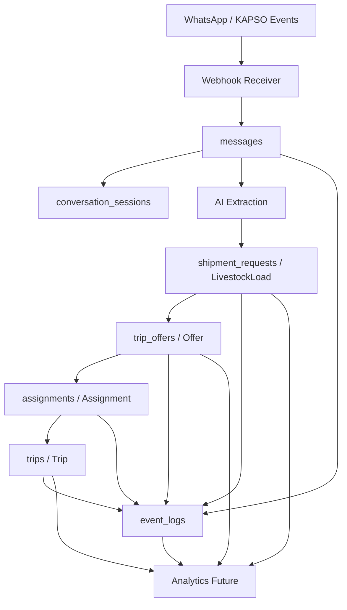

# Arquitectura De Base De Datos

Este documento define la arquitectura conceptual de datos para AGRO Logistics MVP. No incluye SQL, migraciones ni decisiones de infraestructura fisica.

El backend es la unica fuente de verdad del negocio. KAPSO y WhatsApp son canal, no dominio ni persistencia de estado de negocio.

## Objetivo De La Base De Datos

La base de datos del MVP debe soportar:

- Operacion diaria de cargas, ofertas, asignaciones y viajes.
- Trazabilidad completa de mensajes, decisiones y cambios de estado.
- Auditoria mediante `event_logs`.
- Analytics inicial desde el dia 1.
- Manejo explicito de datos incompletos, estimados y confirmados.
- Modo degradado sin KAPSO.

## Principios De Diseno

- Backend-owned: todo estado de negocio vive en backend.
- Event-first: todo cambio relevante genera evento.
- Canal desacoplado: IDs de KAPSO/WhatsApp se guardan como referencias externas.
- Operacional primero: el modelo debe servir al dispatcher antes que a dashboards.
- No mezclar dominio y analytics: transaccional y metricas se separan conceptualmente.
- Idempotencia obligatoria en mensajes, webhooks y eventos.
- Datos incompletos son datos validos si estan marcados como tales.
- Soft delete para preservar auditoria.

## Separacion De Capas De Datos

| Capa | Objetivo | Tablas MVP | Regla |
| --- | --- | --- | --- |
| Transaccional | Estado actual de operacion | `shipment_requests`, `trip_offers`, `assignments`, `trips`, `messages` | Optimizada para operar y validar estados. |
| Auditoria/Eventos | Reconstruir que paso | `event_logs`, `notification_outbox` | Append-only conceptual para eventos; outbox conserva estados de despacho. |
| Analytics futuro | Medir funnel, supply, demand y calidad | Views/modelos futuros dbt/warehouse | No mezclar con escritura transaccional. |

## Entidades Principales

| Tabla | Dominio canonico | Responsabilidad |
| --- | --- | --- |
| `users` | `User` | Identidad base de actores humanos. |
| `producers` | `Producer` | Productor o comisionista que origina cargas. |
| `carriers` | `Carrier` | Transportista que responde oportunidades. |
| `vehicles` | `Vehicle` | Unidad asociada a carrier. |
| `carrier_search_preferences` | `CarrierSearchPreference` | Zonas/criterios para recibir oportunidades, distintas a una disponibilidad fechada. |
| `carrier_route_availabilities` | `CarrierRouteAvailability` | Recorrido, ventana y capacidad declarados por carrier; entidad conceptual, aun no persistida. |
| `shipment_requests` | `LivestockLoad` | Necesidad de transporte. |
| `trip_offers` | `Offer` | Interes, disponibilidad, precio o consulta de carrier. |
| `assignments` | `Assignment` | Seleccion validada por operador. |
| `trips` | `Trip` | Ejecucion logistica. |
| `conversation_sessions` | `ConversationSession` | Conversacion por canal. |
| `messages` | `Message` | Mensaje entrante o saliente. |
| `event_logs` | `EventLog` | Auditoria y lineage operativo. |
| `notification_outbox` | Intencion de notificacion | Entrega diferida, idempotencia y conciliacion de mensajes salientes. |
| `locations` | Location value object | Texto declarado y, cuando hay coincidencia unica, nombre/provincia/ID/version Georef; requiere migracion `0011_georef_location_provenance`. |
| `documents` | Documento operativo | Referencias documentales basicas. |
| `payment_terms` | Condiciones economicas | Condiciones pactadas o estimadas, sin pagos in-app. |
| `risk_flags` | Flags de riesgo | Riesgos operativos o de calidad. |

Las preferencias y disponibilidades se describen como conceptos de producto; su persistencia fisica debe revisarse contra el esquema implementado antes de una migracion. Una disponibilidad no se modela como `Trip`.

## Ownership De Datos

| Dato | Owner | No owner |
| --- | --- | --- |
| Estados de carga, oferta, assignment y trip | Backend | KAPSO, WhatsApp, dashboards |
| Homologacion, preferencias y disponibilidad de recorrido | Backend | KAPSO, WhatsApp, dashboards |
| Respuestas de soporte y aprobacion documental | Backend, con actor operador | AI, canal, cliente backoffice |
| Mensajes y sesiones | Backend | KAPSO |
| IDs externos de canal | Backend como mapeo | Dominio |
| Eventos auditables | Backend | Agentes como fuente final |
| Metricas | Analytics futuro derivado | Tablas transaccionales como logica de negocio |

## Idempotencia

Debe existir idempotencia para:

- Webhooks entrantes.
- Mensajes entrantes y salientes.
- Eventos de KAPSO/WhatsApp.
- Creacion de `trip_offers` desde respuestas.
- Registro de `event_logs`.
- Encolado de notificaciones salientes por clave idempotente unica.

El backend SQL guarda la intencion de notificar en la misma transaccion que el cambio de negocio. Un worker despacha despues del commit. Rechazos explicitos se reintentan con espera; excepciones de red y claims interrumpidos quedan en `RECONCILE_REQUIRED`, porque el proveedor podria haber aceptado antes de perderse la respuesta. El estado no implica entrega al dispositivo, solo aceptacion del proveedor.

Regla minima:

- Deduplicar por `provider` + `idempotency_key`.
- Cuando no exista key estable, usar combinacion de `provider_message_id`, `conversation_external_id`, `event_type` y timestamp externo.
- Un duplicado no debe crear segunda entidad de negocio.

## Soft Delete

No borrar fisicamente entidades operativas en MVP.

Campos sugeridos:

- `deleted_at`
- `deleted_by_user_id`
- `delete_reason`

Regla: soft delete no reemplaza estados de negocio como `CANCELLED` o `CLOSED`. Cancelar una carga o viaje es estado; borrar es decision administrativa.

Regla de consistencia backoffice: borrar una carga o un viaje desde backoffice elimina
administrativamente la operacion completa con soft delete sobre `ShipmentRequest`,
`TripOffer`, `Assignment` y `Trip` relacionados. La trazabilidad queda en `EventLog`;
las vistas operativas y self-service deben usar listados sin `deleted_at`.

## Timestamps

Campos comunes sugeridos:

- `created_at`
- `updated_at`
- `deleted_at`
- `occurred_at` para eventos externos o eventos de negocio.
- `received_at` para mensajes entrantes.
- `sent_at` para mensajes salientes.

Regla: distinguir cuando ocurrio un evento de cuando fue procesado.

## Trazabilidad

Toda entidad derivada desde conversacion debe poder rastrearse hacia:

```text
message -> conversation_session -> event_log -> entidad de dominio
```

Campos de trazabilidad recomendados:

- `source_message_id`
- `conversation_session_id`
- `correlation_id`
- `created_from_event_id`
- `provider_message_id`
- `workflow_execution_id`

## Manejo De Datos Incompletos

Los datos incompletos deben persistirse de forma explicita:

- `missing_critical_fields`
- `requires_human_review`
- `field_confidence`
- `has_ambiguous_location`
- `data_quality_status`

Regla: una `shipment_request` incompleta puede existir, pero no debe publicarse ni confirmarse como completa sin operador.

## Datos Estimados Vs Confirmados

Cada dato critico debe poder distinguir:

| Estado | Uso |
| --- | --- |
| `unknown` | No informado. |
| `estimated` | Aproximado o inferido de lenguaje informal. |
| `provided` | Informado por usuario, no validado. |
| `validated` | Revisado por operador. |
| `corrected` | Modificado luego de nueva informacion. |

Campos sugeridos:

- `field_confidence`
- `validated_at`
- `validated_by_user_id`
- `last_corrected_at`

## Sensibilidad De Datos

| Categoria | Ejemplos | Regla |
| --- | --- | --- |
| `publica` | Texto generico de oportunidad sin datos privados. | Puede usarse en mensajes a carriers. |
| `interna` | Estado operativo, notas internas. | Solo equipo operativo. |
| `personal` | Telefono, nombre de contacto. | Minimizar exposicion. |
| `ubicacion` | Origen, destino, establecimiento. | Compartir solo lo necesario. |
| `sensible_operativa` | Precio, riesgo, cancelacion, confianza. | Requiere control interno. |

## Estrategia Futura Para dbt/Warehouse

En MVP, analytics puede leer de replica o export controlado. Futuro:

- Crear staging models desde tablas transaccionales.
- Crear facts derivados de `event_logs`.
- Crear dimensiones para producers, carriers, locations y fechas.
- Versionar definiciones de metricas en dbt.
- Evitar dashboards directos sobre tablas de escritura cuando escale la operacion.

Modelos futuros sugeridos:

- `stg_messages`
- `stg_event_logs`
- `fct_shipment_funnel`
- `fct_trip_operations`
- `fct_carrier_response`
- `dim_producer`
- `dim_carrier`
- `dim_location`

## Estado De Implementacion MVP

La primera implementacion tecnica usa:

- SQLAlchemy como ORM.
- Alembic para migraciones.
- `DATABASE_URL` como unica configuracion de conexion.
- PostgreSQL/Supabase-ready como destino operativo.
- SQLite solo para tests automatizados de repositorios y transacciones.

Los repositorios in-memory quedan limitados a unit tests y desarrollo local. Para datos reales, la fuente de verdad debe ser la base configurada por `DATABASE_URL`.

La confirmacion de `Assignment` + creacion de `Trip` + registro de `EventLog` se mantiene como un limite transaccional en la capa SQL. Cuando se use PostgreSQL, esa operacion debe ejecutarse dentro de una transaccion de base de datos.

Comandos operativos:

```bash
.venv/bin/alembic upgrade head
.venv/bin/python -m pytest
```

## Diagrama Mermaid



## Riesgos Del Modelo De Datos

1. Mezclar estados actuales con eventos puede generar inconsistencias.
2. Usar IDs externos como IDs internos puede acoplar el dominio a KAPSO.
3. No registrar incertidumbre puede convertir datos estimados en aparentes verdades.
4. Analytics directo sobre tablas operativas puede afectar claridad y performance futura.
5. Soft delete mal usado puede ocultar cancelaciones reales.

## Decisiones Pendientes Con Negocio

1. Campos minimos para publicar una carga.
2. Nivel de detalle necesario para locations rurales.
3. Que datos economicos guardar sin implementar pagos.
4. Que datos pueden ver carriers en mensajes.
5. Que eventos son obligatorios para auditoria operativa inicial.

## Proximo Paso Recomendado

Validar tablas y campos con casos reales de operacion. Luego definir contratos de entidades y eventos antes de escribir migraciones.

## Migraciones agregadas al MVP

- `0011_georef_location_provenance`: identidad Georef/version/procedencia en `locations`.
- `0012_route_availabilities`: disponibilidad independiente con ruta, paradas, ventana, capacidad, tipos admitidos, estado y escenario QA.
- `0013_document_validity`: fechas declaradas `valid_from`/`expires_at` y referencia `supersedes_document_id` para conservar la cadena de renovaciones.

Las tres revisiones pasaron el ciclo up/down/up en PostgreSQL descartable. No se aplicaron a la base PostgreSQL del proyecto ni a Supabase.
