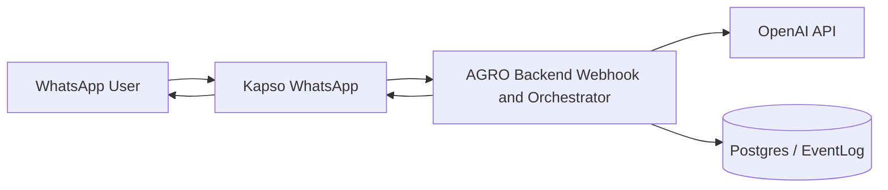

# Kapso Channel Architecture

## Principle

Kapso is the WhatsApp transport layer. The AGRO backend owns the conversation
and business decisions, using the OpenAI configuration held by the backend.
Postgres is the audit trail.

## Responsibilities

### Kapso

- Receives WhatsApp messages.
- Forwards inbound WhatsApp events to the signed backend webhook.
- Sends backend-authored WhatsApp messages.
- Does not run an AI agent for AGRO conversations.

### Backend

- Owns shipment, offer, assignment, trip, and event state.
- Validates state transitions.
- Creates `TripOffer`, `Assignment`, and `Trip`.
- Records `EventLog`.
- Decides what is operationally valid.
- Uses the backend `OPENAI_API_KEY` and `OPENAI_MODEL` for AI extraction.
- Authors and sends conversational replies through its Kapso provider adapter.

### Postgres

- Stores canonical business entities.
- Stores audit history through `EventLog`.
- Allows operators and analytics to reconstruct what happened.

## Flow

## Kapso Assets and Remote Status

- Workflow slug: `agro-whatsapp`
- Function slug: `agro-backend-client`
- Function slug: `search-knowledge`
- Function slug: `escalate-to-human`
- Sandbox WhatsApp phone number ID: `597907523413541`

These are local source-controlled assets. As of 2026-09-28, the remote project
contains neither the `agro-whatsapp` workflow nor the `agro-backend-client`
function. The local workflow trigger is scoped to the Sandbox phone number ID
above. Verify the CLI dry-run and function configuration before publishing.

## Decisions Owned By Backend

- Ask one missing-data question at a time.
- Decide whether a message is likely producer, carrier, or operator intent.
- Search knowledge snippets.
- Ask the backend for active shipments and offers.
- Escalate to a human when ambiguity or unsupported actions appear.
- Format a clear WhatsApp response.

## Decisions Kapso Must Not Make

- Confirm or assign a carrier.
- Change shipment, offer, assignment, or trip state directly.
- Create a trip without the backend.
- Decide final pricing.
- Infer unavailable data as fact.
- Store business state outside backend/Postgres.

## Business Rule Boundary

The backend interprets, responds, validates and persists. Kapso transports messages.

Example:

1. Carrier replies `1`.
2. Kapso forwards/receives inbound context.
3. Backend classifies registered carrier, creates `TripOffer`, and moves `ShipmentRequest` to `MATCHING`.
4. Operator asks Kapso to show offers.
5. Kapso calls `GET /api/v1/admin/shipments/with-offers`.
6. Operator selects.
7. Kapso calls `POST /api/v1/shipments/{shipment_id}/select-offer`.
8. Backend creates `Assignment` and `Trip`.
